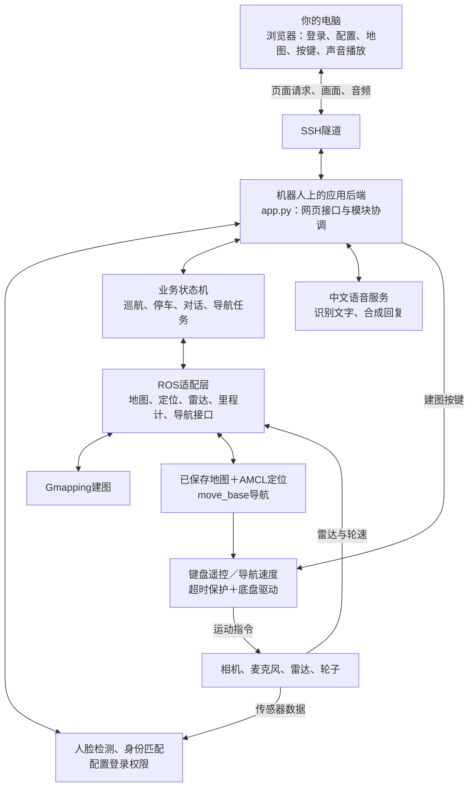

# bobac2 教室巡航服务机器人实训工程

2026-11-05最新运行状态：已切换为键盘建图准备模式，后端启用 `--mapping-teleop --mapping-keyboard`；真实雷达、底盘反馈、里程计和Gmapping已接通，遥控初始暂停。模式切换需重新登录。ROS Master现为独立roscore，不依附静态网页启动进程；实际运动验收仍待完成。以下静态部署说明保留为同日较早记录。


2026-11-05部署更新：最新源码已同步到机器人，旧源码已备份；机器人Python2.7下71项测试通过。静态服务已重启，电脑通过SSH隧道访问 http://127.0.0.1:8765/ 的真实人脸登录入口，相机就绪；未登录配置接口返回401。原运行配置与90张样本保留，导航运动仍关闭。真实登录、浏览器交互、建图和导航仍待验收，详见 [部署记录](deployment_report_20261105.json)。以下11月3日与4日内容为历史开发记录。


2026-11-03 新增人脸登录入口、登录后配置页面、地图选点与键盘建图代码，尚未部署回机器人。离线启动：

```powershell
python .\robot_practicum\scripts\offline_preview.py --port 8766
```

打开 http://127.0.0.1:8766/，点击“开始验证”，使用**明确标记的模拟身份输入**体验界面。实际应用 `/` 改为人脸登录，`/console` 为配置页；直接访问受保护的API也必须登录。新软件状态与实机待测项见 [新操控流程与离线开发记录](新操控流程与离线开发记录.md)。下文早期启动和测试记录不代表新增功能已经通过现场验证。


2026-11-04用户已确认底盘现在可移动，旧“不移动”问题不再列为当前阻塞。本工程新增键盘遥控的方向、松手停车与里程计仍待接回实机验证，不能据此认定新程序已部署或导航已通过。11月3日的首次微动与停车记录作为历史诊断保留，见 [电脑遥控建图与当前诊断](电脑遥控建图与当前诊断.md)。静态、人脸与语音模式仍为默认启动方式；不要把人工建图权限当作已允许自主导航。

本工程将授权人员识别、中文指令和任务调度接入现有 bobac2 ROS 1 系统。当前交付采用静态联调模式：运行真实相机、真实语音接口和人员录入，导航动作由明确标记的模拟器完成，不向电机发布速度。

已配置孟熙恒、周高定、林宸涵、李胜洋四人的名单，实际只录入孟熙恒。教室目标点尚未标定。身份识别90%指标需要独立实测数据，不能用训练样本、连续视频帧或模拟导航结果替代。

2026-11-03用户缩减范围：不开发障碍物类别识别及其90%专项验收，不部署YOLO、不进行专项采图标注或微调；保留现有激光占用/距离检测、导航避障和停车保护。课程计划书的障碍物90%原条款未更改，当前项目未覆盖该条款，不宣称达标。历史配置或报告中的旧待确认文字不构成恢复此任务的指令。

## 系统架构

以下架构图记录当前工程的模块及连接关系（2026-11-04）。代码实现不等同于全部部署或实机验收完成；最新进度与验收条件见 [TASK_PLAN.md](../TASK_PLAN.md)。



## 实际环境与目录

- 机器人：Ubuntu 16.04.7 x86_64，ROS Kinetic，Python 2.7，OpenCV 3.3.1-dev。
- 厂家工作空间：`/home/bobac2/bobac2_ws`，保持原样。
- 新工作空间：`/home/bobac2/bobac_practicum_ws`。
- 配置与运行数据：`/home/bobac2/bobac_practicum_run`。
- 运行配置：`~/bobac_practicum_run/project.json`。首次启动从工程配置复制，之后保留录入和标定配置。
- 人脸样本：`~/bobac_practicum_run/data/faces/p001` 等目录；不打包进源码交付。
- 日志：`~/bobac_practicum_run/data/events.jsonl`，模拟导航与模拟身份输入均有独立标记。
- 彩色图像话题：`/practicum/camera/image_raw`。Astra Pro 的彩色 UVC 与深度接口分开读取。

相机通过 `/dev/v4l/by-id/usb-Astra_Pro_HD_Camera_Astra_Pro_HD_Camera-video-index0` 选择，不依赖可能变化的 video0/video1 编号；断开后会重试。

## 静态系统启动

若当前系统已在运行，不要重复启动。机器人重启后，在相应终端执行：

```bash
# 所有终端先加载环境
source /opt/ros/kinetic/setup.bash
source ~/bobac2_ws/devel/setup.bash
source ~/bobac_practicum_ws/devel/setup.bash
```

```bash
# 终端一：仅在尚无 ROS Master 时启动
roscore
```

```bash
# 终端二：语音服务，不运行厂家会发速度的多模式应用
roslaunch bobac_practicum voice_services.launch
```

```bash
# 终端三：静态应用。不启动底盘、跟随或真实导航。
roslaunch bobac_practicum static.launch
```

可选深度相机：

```bash
roslaunch astra_launch astrapro.launch
```

只使用彩色相机时不强制启动深度处理。不要同时用 NiViewer 或另一采集程序占用彩色相机。

## 在自己电脑使用

Windows 终端建立隧道，地址按机器人实际 IPv4 调整。密码在 SSH 提示中输入，不写进脚本：

```powershell
ssh -N -L 127.0.0.1:8765:127.0.0.1:8765 bobac2@10.224.117.14
```

打开 `http://127.0.0.1:8765/`。服务仅监听机器人回环地址，通过 SSH 隧道访问。首次点击“在电脑扬声器播放回复”，之后页面会尝试自动播放新回复。浏览器限制自动播放时，可点击播放器播放键。

录音仍从机器人 ASTRA Pro 麦克风采集，在线识别和语音合成复用机器人已有讯飞服务。不要在日志或源码中填写新的密钥。识别服务异常会显示错误，不会把空识别结果当成运动指令。

`audio_output` 当前为 `pc`，通过电脑外放；若未来确认机器人音箱接线和实际听感正常，可改为 `robot` 并重启应用。机器人外放尚未通过现场听感确认。

## 人脸录入与验证

1. 选择本人姓名，确认本人同意且画面里只有该人，再录入。
2. 保持正脸、正常光照并缓慢改变角度，程序收集 30 张清晰样本。
3. 使用 OpenCV SSD ResNet-10 检测、OpenFace 128 维特征进行身份匹配。视觉在私有 OpenCV 3.4.2 子进程运行，ROS 进程继续使用原来的 OpenCV 3.3.1-dev。子进程或特征模型失败时明确显示错误，回退到 CLAHE + Haar / LBPH。
4. OpenFace 使用同一人的最相近 3 个模板的平均余弦相似度，当前阈值 0.82（陌生人测试后从 0.75 收紧）；多名已录入人员之间还要求至少 0.08 的领先差。最近 6 个有效帧中当前候选至少匹配 4 帧才确认；超时旧帧、多人和离开画面不会累积授权。页面显示人脸尺寸、亮度、清晰度、相似度和具体提示。
5. 相似度越高表示越相近，它不是准确率。LBPH 距离继续用于诊断与后备，阈值保持 60。两种阈值都需授权人员与陌生人的独立测试校准，不能为提高通过率直接放宽。
6. 补录保留旧样本，采样间隔至少 0.8 秒，跳过近似重复、模糊、过暗、过亮、过小或贴边的人脸。按提示采集正脸、距离变化和小幅转头；最多等待 120 秒。
7. 多人入镜时不选择“最大人脸”授权；未确认人员进入交互时撤销原交互身份。身份撤销后再次有效识别可立即恢复，不受旧播报冷却时间阻塞。持续在镜头前的同一人可在交互超时后重新触发。
8. 模拟身份按钮只用于状态机测试，不作为真实识别成绩。`/api/face-diagnostics` 提供短时数值轨迹，用于区分漏检、质量拦截、距离超阈值与多帧确认；不自动保存额外人脸图像。

独立测试 CSV 格式：

```csv
expected,predicted
```

自行填写独立试验结果，标签使用 p001 至 p004，以及 `unknown`。训练图片不能重复充当测试图片；无脸不能代替陌生人试验。之后执行：

```bash
python scripts/evaluate.py 实测记录.csv
```

工具输出总体正确率、陌生人误接受率和试验数；没有数据时不输出达标结论。统计工具仍支持 `occupied`、`free` 标签，这只表示可统计占用检测数据；当前不安排障碍物90%专项验收，也不能将此统计冒充物体类别识别成绩。

## 导航静态准备（2026-11-03）

2026-11-05实机修正：节点名为 `/move_base_node`，但实际发布的导航 Action 为 `/move_base`，已通过真实发布者与 Action 客户端握手确认。此前将节点名当作 Action 名称的判断有误；配置已改为 `/move_base`。规划服务仍位于 `/move_base_node/make_plan`，两者不可混淆。

下面这条只读命令可以随时执行，不打开电机串口、不发布速度、不发导航目标：

```bash
source /opt/ros/kinetic/setup.bash
source ~/bobac2_ws/devel/setup.bash
source ~/bobac_practicum_ws/devel/setup.bash
python ~/bobac_practicum_ws/src/bobac_practicum/scripts/navigation_preflight.py
```

报告保存在 `~/bobac_practicum_run/navigation_preflight.json`，列出导航包、串口设备名、候选地图及图像是否存在、实际话题发布者和待办。话题出现在 `rostopic list` 中可能只是本应用订阅了它；必须有实际发布者和新数据才算传感器就绪。候选地图一律不自动认定为当前教室。

新增 `navigation_preview.launch`，只包含地图服务器和位于 `practicum_preview` 命名空间的规划器，不含底盘、运动学、手柄、雷达驱动或目标发送器，速度输出重映射到隔离话题。当前仅检查 XML 展开，未启动这个预览，也未启动 `navigation.launch`、`mapping.launch`。底盘已由操作者确认是两轮差速，雷达已验证；当前教室需要新建地图，停放点在建图后指定。正式采图与真实运动仍未开始。

## 私有视觉依赖恢复

已部署在 `~/bobac_practicum_run/vision_deps`。它是 wheel 解包目录，没有执行系统级 pip install，也不修改 ROS 的 PYTHONPATH。`vision_worker.py` 清除 ROS 的环境路径，通过私有标准输入/输出管道传图，使用机器人 CPU 推理；图像不发送到云端。

相机已应用 `brightness=12,gamma=140,backlight_compensation=2`，用于当前侧光环境；原参数记录在 `~/bobac_practicum_run/camera_controls_before.txt`。运行配置的 `camera_controls` 可调整。当前已录入孟熙恒 90 张（原 30 张及两次经本人同意的补录各 30 张），其余三人仍待录入。备份在运行目录的 `backup_20261103_*` 中。

重装时，从 PyPI 的 `opencv-python==3.4.2.17` 版本取得 `opencv_python-3.4.2.17-cp27-cp27mu-manylinux1_x86_64.whl`，核对 SHA256 `4b5902b647e66addfa5218dbc75e7a4de2f46c253ea17b234408f5792cfc8d7f`，解压到上述私有目录并保留 wheel 中的许可文件。适用于本机 Ubuntu 16.04 x86_64 / Python 2.7；不用于替换系统库。

## 状态机与运动边界

流程：巡航 → 发现授权人员 → 取消当前导航并确认停车 → 等待中文指令 → 前往目标点 → 到达播报 → 按需恢复巡航。

处理了等待超时、未知地点、歧义地点、导航失败、取消、重复身份、多人员以及身份切换。停止指令优先于地点解析。没有授权会话不能发起服务导航。

当前 `motion_enabled=false`，启动时也没有 `--allow-motion`。真实运动需要两个条件同时明确启用，并且地图、坐标、雷达、里程计、AMCL 和 Action 服务全部就绪。静态界面不能打开运动开关。

真实导航适配器会校验目标地图身份和有限坐标，检查定位及传感器数据新鲜度；停车交互需要收到取消结果并确认新鲜里程计速度接近零。仍需现场急停及底盘自身保护，不能把软件适配器当作经过认证的安全系统。

工程提供 `mapping.launch` 和 `navigation.launch`，默认不启动底盘/雷达硬件，轮子指令默认关闭；两者使用直接读取真实 `/car_data` 的新里程计，导航仍必须传入实际地图路径。实际采图流程、隔离测试与停放点标定见 [建图流程与停放点标定](建图流程与停放点标定.md)。本次未运行正式建图或真实导航入口。

二维激光观察程序 `perception.py` 只检测距离范围内的占用簇与前方障碍，不判断桌子、椅子等类别。视觉类别识别已移出当前开发范围；无人探索建图的课程口径仍待确认。

## 检查与测试

```bash
python -m unittest discover -s tests -v
# 仅在静态应用运行、现场没有进行人员录入时执行下列集成测试
python tests/integration_static.py
```

集成测试会产生明确标记的模拟事件，不会发送运动目标；测试结束会取消模拟任务。日志中的 `simulated` 表示导航是模拟的，`simulated_input` 单独说明身份事件是否来自测试按钮。

## 对照课程要求的剩余实测

- 两轮差速底盘已由操作者确认，雷达 USB 与扫描已验证；真实底盘反馈、轮径轮距校准和手柄输入仍需现场检查。
- 为当前教室新建地图，地图通过检查后由操作者指定固定停放点，再记录坐标与朝向。
- 在具备急停操作人员的条件下验证真实导航、避障、取消停车和恢复巡航。
- 录入其余三人，安排独立人脸与陌生人试验。
- 明确人脸90%独立验收方法与无人探索建图口径；障碍物类别识别及其90%专项开发已移出当前范围，课程缺项如实记录。
- 机器人外放音箱的接线、供电和实际声音仍需现场确认；电脑外放已由用户确认能听清。

## 模型来源

人脸检测 XML 来自 OpenCV 官方仓库，保留其文件内许可声明：
https://github.com/opencv/opencv/blob/3.4/data/haarcascades/haarcascade_frontalface_default.xml

LBPH 接口参考 OpenCV 官方说明：
https://docs.opencv.org/3.4/df/d25/classcv_1_1face_1_1LBPHFaceRecognizer.html


## 单次现场人脸验证

由操作者确认真实身份，先离开画面再重新进入，画面里只保留测试者。下面两条分两轮执行，不能让两人同时入镜：

```bash
python scripts/face_trial.py --expected p001 --seconds 12 --output ~/bobac_practicum_run/positive_final_trial.json
python scripts/face_trial.py --expected unknown --seconds 12 --output ~/bobac_practicum_run/negative_final_trial.json
```

每轮输出候选匹配帧、实际授权事件、质量合格单人帧和相似度范围，并保存数值轨迹。少于 20 个合格单人帧时会明确标为观察不足。连续帧不是独立试验，不可把这些帧数换算成课程准确率；验收应记录多轮独立进场的预期身份和最终输出，再用 `evaluate.py` 统计。
